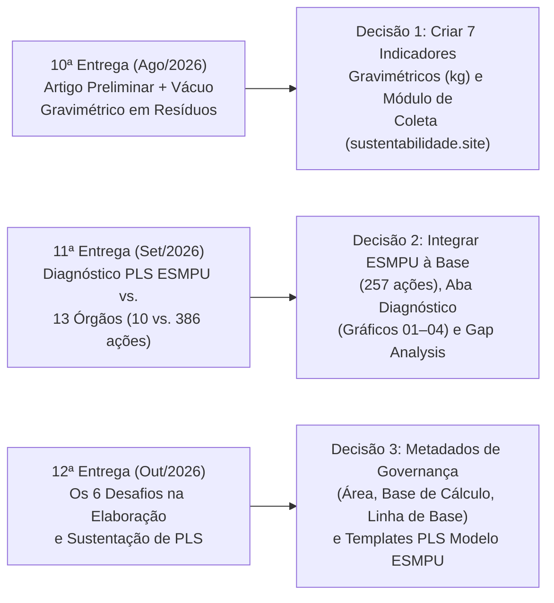

# 📘 Manual Completo e Racional de Decisões – Painel de BI e Assistente PLS (ESMPU v04)

> [!IMPORTANT]
> **Pesquisa Científica**: *"Ministério Público da União Verde: liderando a transformação da gestão sustentável"*  
> **Instituição / Unidade Piloto**: Escola Superior do Ministério Público da União (ESMPU) – Programa de Bolsas de Pesquisa Científica (Processo SEI nº `0.01.000.1.004154/2024-96`).  
> **Marco Regulatório**: Resolução CNMP nº 145/2016, Lei nº 12.305/2010 (PNRS), Lei nº 14.133/2021, Decreto nº 7.746/2012 e IN SEGES/ME nº 43/2020.

---

## 🧭 1. Visão Geral e Arquitetura de Decisões do Projeto

Este manual documenta, seção por seção, o funcionamento do novo **Painel de Business Intelligence e Assistente de Elaboração de Planos de Logística Sustentável (PLS – Versão Consolidada ESMPU v04)**, acompanhado das **capturas de tela reais do sistema** e da **fundamentação metodológica de como cada decisão técnica e científica foi tomada** a partir dos Relatórios de Acompanhamento **10ª, 11ª e 12ª entregas** e do **4º Relatório Trimestral**.



### Por que a ferramenta foi desenhada como uma SPA Web Aberta (*Client-Side*)?
* **Decisão Tomada**: Desenvolver o sistema inteiramente em tecnologias web abertas (`HTML5`, `CSS3`, `JavaScript ES6`, `Chart.js`, `Apache ECharts` e `SheetJS`), processadas diretamente no navegador do usuário, sem exigir banco de dados proprietário ou licenças comerciais (como Power BI Pro ou Tableau).
* **Fundamentação (Desafio 1.6 do Relatório 12)**: O diagnóstico institucional apontou que a dependência de ferramentas proprietárias e de licenças pagas condiciona e atrasa a implantação do monitoramento nas unidades do MPU. A arquitetura aberta garante **transferência tecnológica imediata e gratuita para a ESMPU**, funcionando tanto online via GitHub Pages (`https://logisticasustentavel.github.io/pls/`) quanto localmente via servidor nativo Windows (`iniciar_painel.bat`).

---

## 🖥️ 2. Guia Ilustrado das 10 Seções e Fundamentação das Decisões

---

### 🏠 Seção 1: Início (Capa Executiva e Atalhos de Escopo)


#### O que faz esta seção:
1. **Cockpit de Apresentação e KPIs Globais**: Exibe em tempo real os 4 grandes números da base consolidada:
   * **257 Iniciativas Mapeadas** (71 das demais unidades do MPU + **10 da ESMPU** + 176 de 13 órgãos públicos de referência);
   * **3 Eixos de Atuação** (*Energia Elétrica*, *Água* e *Resíduos Sólidos*);
   * **7 Estados Avaliados (UFs)**;
   * **27 Órgãos / Unidades**.
2. **Atalhos de Unidade / Escopo (`ESMPU`, `MPU`, `Outros Órgãos`)**: Três botões de filtragem instantânea que recalibram todas as 9 abas do painel com um único clique:
   * `🎓 ESMPU (Unidade Piloto)`: Isola exclusivamente as **10 ações do PLS 2026–2028 da ESMPU**.
   * `🛡️ MPU (Todos)`: Filtra as **81 iniciativas** das unidades do Ministério Público da União (`ESMPU`, `PGR`, `MPT`, `PR-BA`, `PR-DF`, `PR-RJ`, `PR-SP`, `PRR1`, `PRR2`, `PRR3`, `PRR4` e `PRMs`).
   * `🏢 Outros Órgãos`: Filtra as **176 iniciativas** dos 13 órgãos externos da amostra comparativa (`STF`, `STJ`, `TST`, `STM`, `TCU`, `Senado Federal`, `Câmara dos Deputados`, `TJBA`, `TJRJ`, `MPERJ`, `MPEPE`, `MPEBA` e `MPERS`).
3. **Barra Lateral Direita (*Personalizar*)**: Permite alternar entre 4 temas visuais (*Areia/Praia*, *Claro*, *Escuro* e *Alto Contraste*), ajustar o **Zoom Global (50% a 150%)** e customizar a cor de cada Eixo Temático com propagação automática em todos os gráficos.

#### 🧠 Como as decisões foram tomadas:
* **Inclusão da ESMPU na base principal (`Iniciativas_Consolidadas_20260309_v03.xlsx`)**: Na versão anterior (`v03`), a planilha possuía 247 registros e ainda não continha a ESMPU. Com a formalização da **ESMPU como Unidade Piloto** (homologada pela Comissão de Sustentabilidade, SEPE e Diretoria-Geral nos Despachos SEI nº `0702710`, `0703463` e `0703781`, de outubro de 2026), decidimos incorporar as 10 ações do item *"7. Plano de Ações e Metas"* do PLS 2026–2028 da Escola diretamente na base e criar o botão dedicado **`ESMPU (Unidade Piloto)`** na capa.
* **Remoção da barra de topo em favor da Barra Lateral Permanente**: Decisão tomada para maximizar a área vertical útil (*viewport*) dos gráficos em projeções de reuniões da Comissão de Sustentabilidade.

---

### 📊 Seção 2: Análise por Eixos de Atuação


#### O que faz esta seção:
1. **Gráfico de Volume Detalhado por Eixo**: Compara o volume absoluto de iniciativas nos 3 eixos do recorte metodológico: **Energia Elétrica (124 ações)**, **Água (96 ações)** e **Resíduos Sólidos (37 ações)**. Clicar em qualquer barra aplica *cross-filtering* em todo o painel.
2. **Nuvem de Termos (*WordCloud*)**: Processa dinamicamente os textos das *Ações Brutas* e das *Ações Consolidadas* (removendo *stopwords* da língua portuguesa) para destacar os conceitos mais frequentes (`consumo`, `energia`, `água`, `resíduos`, `equipamentos`, `eficiência`, `monitoramento`, `campanhas`, `sustentáveis`). Quando um eixo é filtrado, a nuvem assume automaticamente a cor temática daquele eixo.

#### 🧠 Como as decisões foram tomadas:
* **Recorte Metodológico nos 3 Eixos Críticos (Relatórios 10 e 11)**: Embora os PLS contemplem múltiplos temas, a pesquisa estabeleceu o recorte em **Água, Energia Elétrica e Resíduos Sólidos** por representarem o núcleo de impacto ambiental direto e de desembolso operacional nos edifícios públicos, permitindo diagnóstico empírico profundo sobre maturidade técnica:
  * **Energia Elétrica**: Eixo de **maior maturidade e densidade técnica** (predomínio de automação/LED e expansão fotovoltaica);
  * **Água**: **Nível intermediário de maturidade** (foco em modernização hidráulica);
  * **Resíduos Sólidos**: Identificado como o **principal gargalo e ponto cego de governança ambiental do MPU** (predomínio de ações de redução na fonte e campanhas, mas ausência de indicadores gravimétricos contínuos).

---

### 📍 Seção 3: Distribuição Geográfica e Institucional


#### O que faz esta seção:
1. **Mapa Coroplético Interativo do Brasil (`#map-brasil`)**: Colore as Unidades Federativas conforme a densidade de iniciativas mapeadas.
2. **Painel de Detalhes Selecionados (`#geo-details-panel`)**: Ao clicar em um estado no mapa (como a **Bahia - BA** com 21 iniciativas ou o **Distrito Federal - DF** com 113 iniciativas, incluindo a ESMPU), exibe instantaneamente a contagem de ações daquele estado agrupadas por Eixo Temático. Clicar em um dos cartões do detalhe leva o usuário diretamente à tabela filtrada na aba *Relatórios*.
3. **Ranking de Órgãos/Unidades**: Exibe o Top 10 das unidades com maior volume de iniciativas dentro do recorte geográfico ativo.

#### 🧠 Como as decisões foram tomadas:
* **Comparabilidade Regional e Federal**: A pesquisa analisou tanto órgãos sediados no Distrito Federal (`ESMPU`, `PGR`, `MPT`, `PR-DF`, `PRR1`, `STF`, `STJ`, `TST`, `STM`, `TCU`, `Senado`, `Câmara`) quanto unidades estaduais (`RJ`, `PE`, `RS`, `BA`, `SP`, `PR`), permitindo verificar se boas práticas (como usinas fotovoltaicas ou captação pluvial) estavam restritas às sedes em Brasília ou capilarizadas nas Procuradorias Regionais e Estaduais.

---

### 💡 Seção 4: Insights Estratégicos (Pareto e Matriz de Calor por Instituição)


#### O que faz esta seção:
1. **4 Cartões de Destaque no Topo**:
   * **Unidade Líder no Filtro**: Identifica a instituição com maior número de iniciativas mapeadas no escopo ativo (`MPERJ` com 34 iniciativas na visão global, ou `PGR` com 15 no filtro MPU).
   * **UF com Maior Concentração**: Destaca o estado líder (`DF` com 113 iniciativas).
   * **Unidade Piloto (ESMPU)**: Card interativo destacado em vermelho/coral (`10 Ações em 3 Eixos`) que funciona como atalho direto para abrir o **Diagnóstico Institucional da ESMPU**.
   * **Eixo Predominante**: Aponta o eixo com maior volume de ocorrências no filtro ativo.
2. **Análise de Pareto: Iniciativas por Unidade/Instituição**: Gráfico de barras ordenado decrescentemente por instituição (`MPERJ`, `Câmara dos Deputados`, `TCU`, `STJ`, `PGR`, `TJRJ`, `MPEPE`, `STF`, `MPERS`, `TJBA`, `STM`, **`ESMPU`** destacada em vermelho/coral, `PR-RJ`, `Senado`, `PRR3`, `PR-BA`, `PR-DF`, etc.).
3. **Matriz de Calor (*Heatmap*): Eixo vs. Unidade/Instituição (Top 12)**: Cruza as unidades na vertical com os 3 eixos na horizontal. A opacidade de cada célula é proporcional à concentração de iniciativas daquele órgão naquele eixo, utilizando as cores temáticas da legenda.

#### 🧠 Como as decisões foram tomadas:
* **Correção Estrutural `Órgão` vs. `Unidade`**: Na planilha original, a coluna `Órgão` continha apenas o agrupamento macro (`MPU` ou `Outros Órgãos`), enquanto a sigla real da instituição (`STF`, `PGR`, `ESMPU`, `TCU`) ficava na coluna `Unidade`. Isso fazia com que, na versão anterior, o gráfico de Pareto e o Heatmap mostrassem apenas 2 barras/linhas genéricas. **Decisão técnica**: Recalibramos os motores `renderPareto()` e `renderHeatmap()` para agregar pela coluna **`Unidade`**, garantindo que a **ESMPU** apareça explicitamente na Matriz de Calor e com cor de destaque no Pareto para comparação imediata com os demais órgãos.

---

### 🧭 Seção 5: Desafios & Soluções Práticas (Mapeamento das Dificuldades do 12º Relatório)

````carousel

<!-- slide -->

<!-- slide -->

````

#### O que faz esta seção:
A aba **`🧭 Desafios & Soluções`** (`screen-desafios`) é a área transversal e prática dedicada ao **mapeamento das dificuldades enfrentadas pelas unidades na elaboração e sustentação de um PLS** (conforme sistematizado no **12º Relatório de Acompanhamento** a partir dos planos da ESMPU 2016 e 2026–2028, do MPF 2024–2026 e do Relatório MASA/MPT 2025):

1. **KPIs de Governança e Filtro por Fase do Ciclo**:
   * Divide os **6 Desafios Críticos** e as **18 Diretrizes e Soluções Práticas** em duas grandes fases clicáveis:
     * **Etapa 1: Formulação & Padronização (`Desafios 1.1 a 1.3`)**;
     * **Etapa 2: Articulação, Rotina & Ferramentas (`Desafios 1.4 a 1.6`)**.
   * Conta com o botão **`Exportar Guia de Soluções (PDF)`** para imprimir o manual prático de bolso da Comissão de Sustentabilidade e o botão **`Aplicar Soluções no Monte seu PLS`**.
2. **Os 6 Cartões Estruturados (Problema Real → Evidência Documental → Protocolo Prático de 3 Passos → Ação na Ferramenta)**:
   * **Desafio 1.1 – Construir o diagnóstico e a linha de base**:
     * *Dificuldade*: Dados dispersos entre áreas/sistemas internos e unidades em prédios compartilhados sem hidrômetro ou medidor próprio.
     * *Solução Prática*: Protocolo de 3 exercícios (2023–2025) em planilha única; **regra prática de rateio proporcional por área ocupada ($m^2$) ou população residente** para prédios compartilhados; e registro obrigatório do marco zero em cada ação.
   * **Desafio 1.2 – Definir indicadores e metas adequados (Bases de Cálculo e Gravimetria)**:
     * *Dificuldade*: Bases de cálculo diferentes (*total, per capita, por $m^2$*), distorções causadas por **público flutuante** (como alunos e eventos em uma escola) e medição de Resíduos Sólidos apenas por indicadores de processo (campanhas) em vez de peso em `kg`.
     * *Solução Prática*: Adoção da **População Equivalente Ponderada** combinada com indicador por $m^2$; transição gradual processo → pesagem gravimétrica em `kg` (Cooperativas, Compostagem e Aterro); e janela anual de calibragem de metas após 12 meses.
   * **Desafio 1.3 – Padronizar conceitos, estruturas e nomenclaturas**:
     * *Dificuldade*: Cada ramo do MPU estrutura seu plano de forma diferente (diretrizes na ESMPU, matrizes no MPF, subeixos no MPT) e batiza ações iguais com nomes distintos.
     * *Solução Prática*: **Arquitetura em Camada Dupla** — preserva a liberdade da unidade para descrever sua *"Ação Bruta / Forma de Trabalho"*, mas vincula-a a uma das **17 categorias de Ação Consolidada** para garantir comparabilidade nacional.
   * **Desafio 1.4 – Articular as áreas executoras e engajar as unidades**:
     * *Dificuldade*: A Comissão de Sustentabilidade coordena o plano, mas depende de Compras, Contratos, Engenharia, Comunicação, Gestão de Pessoas e TI para executar as ações e informar dados.
     * *Solução Prática*: **Matriz de Corresponsabilidade Nominal** (vinculação obrigatória da Área Responsável em cada ação do PLS), designação de 1 ponto focal/agente de sustentabilidade por secretaria e devolutiva visual trimestral com os gráficos do painel.
   * **Desafio 1.5 – Transformar o monitoramento em rotina institucional**:
     * *Dificuldade*: Prever o acompanhamento no texto do PLS é fácil, mas manter a coleta mensal e preservar séries comparáveis quando critérios mudam é o maior gargalo operacional.
     * *Solução Prática*: Calendário fixo por natureza do dado (mensal para faturas/pesagem, trimestral para contratos/campanhas, anual para balanço); preservação da população e área de cada período na série histórica; e emissão em 1 clique de boletins PDF/XLSX para o processo SEI.
   * **Desafio 1.6 – Dispor de ferramentas abertas e capacidades técnicas**:
     * *Dificuldade*: Dependência de licenças pagas de BI e necessidade de treinamento complexo travam a implantação do acompanhamento.
     * *Solução Prática*: Uso de aplicação web aberta (*Zero Licença*), templates pré-configurados (*PLS Modelo ESMPU*) para não começar do zero e kit autônomo de transferência tecnológica (`iniciar_painel.bat`).
3. **🧮 Simulador Prático: Base de Cálculo & Público Flutuante (Desafio 1.2)**:
   * Ferramenta interativa onde o gestor digita a **População Fixa** (ex.: 280 servidores/terceirizados), o **Público Flutuante Médio/Mês** (ex.: 340 alunos/participantes), o **Peso Presencial do Flutuante (%)** (ex.: 50%) e a **Área Construída ($m^2$)** (ex.: $12.500\text{ m}^2$), juntamente com os consumos mensais de Energia (`kWh`), Água ($m^3$) e Resíduos (`kg`).
   * O simulador calcula em tempo real a **População Equivalente Ponderada** ($280 + 340 \times 0{,}50 = 450\text{ pessoas}$), alerta o percentual de distorção que seria cometido caso o público flutuante fosse ignorado (`+60,7%` de erro no *per capita*) e exibe lado a lado os indicadores **por habitante equivalente** e **por metro quadrado ($m^2$)**.
4. **☑️ Roteiro Prático de Superação (Checklist Interativo de 12 Itens)**:
   * Lista de autoavaliação com 12 providências práticas ligadas aos Desafios `1.1` a `1.6`. Conforme a comissão marca ou desmarca cada item, o KPI **`Checklist de Maturidade Ativo`** no topo da tela é atualizado instantaneamente.

#### 🧠 Como as decisões foram tomadas:
* **Equilíbrio entre Rigor Metodológico e Praticidade Operacional ("Sem dificultar demais, mas sem facilitar demais")**:
  * Se colocássemos apenas um texto resumido dos desafios, a ferramenta seria passiva ("facilitar demais" sem resolver o problema prático do gestor). Por outro lado, se exigíssemos fórmulas estatísticas complexas ou cadastros burocráticos extensos, as equipes não usariam ("dificultar demais").
  * **Decisão tomada**: Criamos um módulo onde cada dificuldade apontada no Relatório 12 já traz **3 regras práticas de bolso**, um **botão de atalho direto** para a tela onde aquilo é resolvido, um **Simulador de População Equivalente** (que resolve na hora a dúvida de como calcular *per capita* em uma escola com público flutuante) e um **Checklist de 12 passos** para guiar as reuniões da Comissão de Sustentabilidade.

---

### 🚧 Seção 6: Diagnóstico Institucional ESMPU ("Em Construção" + Acervo Técnico Guardado)

````carousel

<!-- slide -->

<!-- slide -->

<!-- slide -->

````

#### O que faz esta seção:
1. **Sinalização Institucional de "Em Construção" (`Em breve`)**:
   * Na barra lateral, o botão exibe o ícone de construção (`🚧`) e a etiqueta **`Em breve`**.
   * Ao abrir a seção, o usuário visualiza o painel oficial **"Módulo em Construção — Aguardando Tratativas Finais do Piloto com a ESMPU"**, que explica com precisão a situação institucional registrada no **Processo SEI nº 0.01.000.1.004154/2024-96** (Despachos SEI nº `0702710` da Comissão de Sustentabilidade, nº `0703463` da SEPE e nº `0703781` da Diretoria-Geral): o Plano de Ação e o Termo de Compromisso já foram validados, e o grupo aguarda a conclusão das tratativas operacionais finais para aplicação dos questionários, entrevistas e validação assistida in loco junto à equipe responsável pelo PLS 2026–2028 da ESMPU.
2. **Linha do Tempo do Piloto (4 Marcos)**:
   * **Etapa 1 (Concluída)**: *Análise Documental Preliminar* (PLS ESMPU 2016 e 2026–2028);
   * **Etapa 2 (Concluída)**: *Validação SEI do Plano de Ação* (Comissão, SEPE e Diretoria-Geral);
   * **Etapa 3 (Em Andamento / Aguardando)**: *Tratativas Finais & Escuta Técnica* (Questionários e entrevistas na ESMPU);
   * **Etapa 4 (Próxima Etapa)**: *Consolidação do Piloto & PLS Modelo* (Publicação definitiva nesta aba).
3. **Acervo Técnico Guardado (`📦 Consultar Dados Preliminares Guardados`)**:
   * Nada do trabalho analítico já produzido na 11ª entrega foi perdido ou apagado! Clicando no botão **`Consultar Dados Preliminares Guardados (Prévia Documental)`**, o sistema expande sob demanda todo o acervo documental preliminar já pronto:
     * Os **4 KPIs e os Gráficos Comparativos 01 a 04** (*Demais Órgãos $n = 386$ × ESMPU $n = 10$*);
     * A **Matriz de Cobertura e Lacunas Temáticas (*Gap Analysis*)** (6 categorias cobertas e 11 lacunas temáticas, com o botão `+ Suprir Lacuna`);
     * A **Tabela de Consolidação das 10 Ações Brutas vs. Consolidadas do PLS 2026–2028 da ESMPU**.

#### 🧠 Como as decisões foram tomadas:
* **Respeito ao Rito Institucional da Unidade Piloto sem Perder o Trabalho Técnico**:
  * Conforme destacado no **12º Relatório (Seção 3, p. 5)** e no **4º Relatório Trimestral (Seção 4, p. 4)**, a validação formal do Plano de Ação pela ESMPU ocorreu ao final do trimestre (outubro de 2026), de modo que a aplicação presencial/remota dos questionários e entrevistas junto à Comissão de Sustentabilidade ficou programada para a etapa subsequente.
  * Apresentar o diagnóstico da ESMPU como "definitivo" antes de ouvir a equipe gestora da Escola poderia soar prematuro institucionalmente; por outro lado, descartar os gráficos e tabelas já construídos na 11ª entrega desperdiçaria um ativo científico valioso.
  * **Decisão tomada**: Colocar a aba com o selo **"Em Construção — Aguardando Tratativas Finais do Piloto com a ESMPU"** como visão principal (demonstrando transparência e deferência institucional à Comissão de Sustentabilidade da Escola) e manter todos os gráficos e tabelas preliminares **guardados num cofre expansível (`#diag-saved-archive-container`)**, prontos para serem consultados em reuniões ou ativados em definitivo assim que a escuta for concluída.

---

### 🎯 Seção 7: Sistema de Indicadores de Sustentabilidade (50 Indicadores Classificados)


#### O que faz esta seção:
1. **KPIs e Gráfico de Distribuição por Eixo**: Exibe o total de **50 indicadores monitorados** (34 em *Resíduos*, 8 em *Energia Elétrica* e 8 em *Água*), distribuídos em **3 Eixos Estratégicos** e **2 Fontes Consolidadas** (`PLS MPDFT 2022` e `Equipe`).
2. **Filtros Combinados (Eixo + Fonte + Categoria + Busca Textual)**: Permite filtrar rapidamente indicadores por natureza técnica (`gravimétrico / monitoramento`, `gravimétrico / coleta seletiva`, `gravimétrico / reciclagem`, `eficiência`, `eficiência hidráulica`, `gestão de contrato`, `redução na fonte`, `reúso e pluvial`, `logística reversa`, `energia renovável`, etc.).
3. **Tabela Interativa com Vinculação Direta ao PLS**: Lista ID, Nome do Indicador, Eixo colorido, Categoria, Requisitos de medição e o botão **`+ Adicionar`**, que vincula o indicador diretamente às ações do *Monte seu PLS*.

#### 🧠 Como as decisões foram tomadas:
* **Higienização das Categorias e Criação dos 7 Indicadores Científicos da Equipe (IDs 44 a 50)**:
  * Ao inspecionar o arquivo original `indicadores_normalizado.xlsx`, constatamos que todos os indicadores de Água e Resíduos (IDs 9 a 43) estavam marcados como `"não classificado"`, e os requisitos dos IDs 1 a 4 e 7 apresentavam erro de serialização XML.
  * Além disso, o **Relatório 10 (p. 2)** e o **Relatório 12 (item 1.2)** destacaram que *"nenhuma unidade do MPU analisada possui indicadores gravimétricos de monitoramento contínuo (quilogramas de resíduos gerados, frações recicladas, compostadas ou enviadas a aterros)"*, limitando-se a indicadores de processo (como número de campanhas).
  * **Decisão tomada**: Classificamos integralmente os 43 indicadores existentes e adicionamos **7 novos indicadores formulados pela Equipe de Pesquisa (`Fonte: Equipe`)**:
    * **ID 44**: `GERAÇÃO TOTAL DE RESÍDUOS SÓLIDOS - KG` (*gravimétrico / monitoramento*)
    * **ID 45**: `GERAÇÃO PER CAPITA DE RESÍDUOS SÓLIDOS - KG/PESSOA` (*considerando população fixa + flutuante*)
    * **ID 46**: `RESÍDUOS ORGÂNICOS DESTINADOS À COMPOSTAGEM - KG` (*gravimétrico / reciclagem*)
    * **ID 47**: `REJEITOS ENVIADOS A ATERRO SANITÁRIO - KG` (*gravimétrico / monitoramento*)
    * **ID 48**: `TAXA DE DESVIO DE ATERRO / RECUPERAÇÃO GRAVIMÉTRICA (%)` (*razão entre peso reciclado/compostado e peso total gerado*)
    * **ID 49**: `CONSUMO ANUAL DE ÁGUA PER CAPITA - M³/PESSOA` (*eficiência hidráulica*)
    * **ID 50**: `VOLUME DE ÁGUA PLUVIAL CAPTADA E APROVEITADA - M³` (*reúso e pluvial*)

---

### 🛍️ Seção 8: Assistente "Monte seu PLS" (Fluxo em 3 Etapas e Templates ESMPU)

````carousel

<!-- slide -->

<!-- slide -->

````

#### O que faz esta seção:
O módulo gamificado **"Monte seu PLS"** guia o gestor na construção estruturada de um Plano de Logística Sustentável em **3 etapas sequenciais**, acompanhadas em tempo real pela barra lateral direita (**Resumo do PLS**):
1. **Barra Superior de Sessão e Templates da ESMPU**:
   * `🎓 PLS ESMPU (Base)`: Carrega instantaneamente as **10 ações vigentes do PLS 2026–2028 da ESMPU**, agrupadas nas 6 categorias consolidadas correspondentes, com seus respectivos indicadores e metadados.
   * `✨ PLS Modelo ESMPU (Completo)`: Carrega o **PLS Modelo completo da ESMPU (17 ações consolidadas e 42 vínculos de métricas)**, unindo as ações já existentes no PLS 2026–2028 da Escola às **11 recomendações técnicas da pesquisa** para fechar todas as lacunas de monitoramento, coleta seletiva, logística reversa, águas pluviais, reúso e energia renovável.
   * `Carregar JSON` / `Salvar JSON`: Permite salvar o trabalho no computador e retomá-lo a qualquer momento.
   * `Exportar XLSX` / `Gerar Relatório PDF`: Gera o documento formal do PLS pronto para impressão, reunião ou anexação ao SEI.
2. **Etapa 1 – Seleção de Eixos Estratégicos**: Escolha visual dos eixos que comporão o escopo do plano (*Água*, *Energia Elétrica*, *Resíduos*).
3. **Etapa 2 – Ações & Formas de Trabalho (Com Taxonomia e Metadados de Governança)**:
   * **Dropdown de Taxonomia Padronizada**: O usuário escolhe uma das 17 *Iniciativas Padronizadas (Ações Consolidadas)* do eixo ou seleciona `[Outra Ação / Personalizada...]`.
   * **Forma de Trabalho Operacional (Ação Bruta)**: Campo descritivo onde o órgão detalha como executará a ação localmente.
   * **5 Novos Campos de Governança (Desafios 1.1, 1.2 e 1.4 do Relatório 12)**:
     1. **Área Responsável**: *Comissão de Sustentabilidade*, *Engenharia e Manutenção*, *Compras e Licitações*, *Contratos e Serviços Gerais*, *Comunicação Social*, *Gestão de Pessoas* ou *TI*.
     2. **Periodicidade de Coleta**: *Mensal*, *Trimestral*, *Semestral*, *Anual* ou *Contínua*.
     3. **Base de Cálculo**: *Total Absoluto*, *Per Capita (Pop. Fixa + Flutuante)*, *Por Área Construída ($m^2$)*, *Gravimétrico Contínuo (kg)* ou *Indicador de Processo / Entrega*.
     4. **Linha de Base (2023–2025)**: Registro do retrato histórico da unidade.
     5. **Meta (2026–2028)**: Alvo quantitativo ou qualitativo do ciclo.
4. **Etapa 3 – Vinculação de Indicadores**: Exibe, para cada ação cadastrada, cartões clicáveis (`checkboxes`) apenas dos indicadores pertencentes àquele eixo temático, permitindo associar múltiplas métricas de aferição a cada ação.

#### 🧠 Como as decisões foram tomadas:
* **Resolução direta do Quadro-Síntese do Relatório 12 (Seção 2, p. 4) e preparação da 15ª Entrega (20/01/2027)**:
  * O Relatório 12 identificou que a principal dificuldade da ESMPU e dos demais ramos do MPU não está na redação inicial do plano, mas na **sustentação do ciclo**: falta de definição de quem coleta cada dado (*Desafio 1.4 - Articulação das áreas*), divergência nas bases de cálculo diante de público flutuante (*Desafio 1.2 - Indicadores e metas*), perda da referência histórica (*Desafio 1.1 - Linha de base 2023–2025*) e nomenclaturas díspares (*Desafio 1.3 - Padronização*).
  * Ao incorporar esses 5 campos diretamente na Etapa 2 do *Monte seu PLS* e criar o botão **`PLS Modelo ESMPU (Completo)`**, a ferramenta já entrega pronto o **esboço de PLS "modelo" tendo o plano vigente da ESMPU como referência**, previsto para o encerramento do ciclo de entregas.

---

### 📋 Seção 9: Coleta Padronizada & Monitoramento Rotineiro (Gravimetria e Série Histórica)

````carousel

<!-- slide -->

````

#### O que faz esta seção:
1. **Integração com o Portal Externo e Exportação**: Disponibiliza atalho direto para o formulário eletrônico de coleta primária (`http://sustentabilidade.site`), botão para recarregar a **Série Piloto ESMPU (2023–2026)** e botão **`Exportar Planilha de Coleta`** (`.xlsx`).
2. **Formulário de Registro Periódico de Consumo e Gravimetria**:
   * **Parâmetros de Normalização**: *Unidade/Órgão*, *Período (Mês/Ano)*, *População de Referência (Fixa + Flutuante)* e *Área Construída ($m^2$)*.
   * **Energia e Água**: *Energia Consumida (kWh)*, *Geração Fotovoltaica (kWh)*, *Água Consumida ($m^3$)* e *Água de Reúso / Pluvial ($m^3$)*.
   * **Pesagem Gravimétrica de Resíduos Sólidos (em kg)**: Campos específicos para **`Recicláveis → Cooperativas (kg)`**, **`Orgânicos → Compostagem (kg)`** e **`Rejeitos → Aterro Sanitário (kg)`**, além da **Área Responsável pelo Envio**.
3. **Gráfico Empilhado de Monitoramento Gravimétrico e Tabela da Série Histórica**:
   * Ao clicar em **`+ Registrar Medição na Série Histórica`**, o sistema calcula instantaneamente:
     * $\text{Consumo Energético Per Capita} = \frac{\text{kWh}}{\text{População}}$ e $\text{por } m^2$;
     * $\text{Consumo Hídrico Per Capita} = \frac{m^3}{\text{População}}$;
     * $\text{Resíduos Total Gerado (kg)} = \text{Recicláveis (kg)} + \text{Compostagem (kg)} + \text{Aterro (kg)}$;
     * $\text{Taxa de Desvio de Aterro (\%)} = \frac{\text{Recicláveis} + \text{Compostagem}}{\text{Resíduos Total}} \times 100$.
   * O gráfico empilhado mostra visualmente a transição da **Linha de Base (2023–2025)** para o **Monitoramento Mensal (2026)**, evidenciando a redução progressiva da fração vermelha (*Rejeitos → Aterro Sanitário*) e o crescimento das frações verde (*Cooperativas*) e azul (*Compostagem*).

#### 🧠 Como as decisões foram tomadas:
* **Superação do Vácuo de Monitoramento Histórico (Relatórios 10, 11 e 12 - Desafio 1.5)**:
  * No **Relatório 10 (p. 3)**, foi relatado que *"criou-se o formulário para incorporar os campos de entrada quantitativos (pesagem em kg de resíduos gerados, volume enviado para cooperativas e destinação a aterros), fornecendo a infraestrutura digital necessária para sanar o vácuo de monitoramento histórico das unidades"*.
  * No **Relatório 12 (item 1.5)**, destacou-se que o PLS de 2016 da ESMPU já previa indicadores e o PLS 2026–2028 prevê monitoramento mensal, mas faltava operacionalizá-lo em rotina com séries comparáveis.
  * **Decisão tomada**: Integrar o formulário de coleta e o motor de cálculo gravimétrico dentro do próprio Painel de BI, permitindo que a Comissão de Sustentabilidade da ESMPU veja imediatamente o efeito de cada medição mensal sobre os indicadores *per capita*, por $m^2$ e sobre a *Taxa de Desvio de Aterro*.

---

### 🗄️ Seção 10: Relatórios e Auditoria da Base de Dados


#### O que faz esta seção:
1. **Tabela Auditável de Alta Performance (257 registros)**: Exibe todas as iniciativas consolidadas com paginação rápida (50 registros por página), **Busca Textual Global** no topo e **Filtros Independentes por Coluna** (*Eixo*, *Estado*, *Órgão*, *Unidade* e *Iniciativa Consolidada*).
2. **Motor Inteligente de Exportação (`Gerar Relatório`)**:
   * Detecta automaticamente todos os filtros aplicados no painel (cliques em gráficos, mapa, atalhos da capa ou buscas na tabela).
   * Permite ao usuário escolher entre exportar apenas os **Dados Filtrados (WYSIWYG)** ou a **Base Completa**.
   * Exporta tanto em **Planilha Excel (`.xlsx`)** quanto em **Relatório Executivo PDF** (com cabeçalho institucional indicando a data de geração, total de registros e os filtros exatos utilizados na análise).

#### 🧠 Como as decisões foram tomadas:
* **Otimização de Performance e Conformidade Institucional**: Conforme registrado na documentação técnica, a coluna de texto longo *"Iniciativa Bruta"* foi omitida da renderização primária da grade geral (mantendo-se dedicada na tabela específica de diagnóstico da ESMPU e no motor da nuvem de termos) para garantir rolagem instantânea em qualquer computador, enquanto o cabeçalho de rastreabilidade de filtros no PDF garante segurança e transparência em auditorias e reuniões do Comitê Científico Consultivo (CCIC) e da Comissão de Sustentabilidade.

---

## 📊 3. Resumo Geral: Como Cada Relatório Moldou o Novo Painel

| Fonte Documental | Achado / Exigência Principal da Pesquisa | Decisão Implementada no Painel (v04) |
| :--- | :--- | :--- |
| **10ª Entrega** (`REL_ACOMP_v10`) | Ausência total de indicadores gravimétricos contínuos (kg) em Resíduos Sólidos nas unidades do MPU; criação do canal de coleta primária (`sustentabilidade.site`). | Criação dos **7 novos indicadores científicos (IDs 44–50)** com pesagem em `kg` e implementação da **Aba 8 – Monitoramento & Coleta Padronizada** com gráfico empilhado de gravimetria (Cooperativas, Compostagem e Aterro). |
| **11ª Entrega** (`REL_ACOMP_v11`) | Diagnóstico do PLS 2026–2028 da ESMPU (10 ações) comparado a 13 órgãos (386 ocorrências); identificação de 6 categorias cobertas e 11 lacunas temáticas; Gráficos 01 a 04. | Inclusão das **10 ações da ESMPU** na base (`v03.xlsx` → 257 ações); criação do atalho **`ESMPU (Unidade Piloto)`** na Capa; destaque da ESMPU no Pareto/Heatmap; e criação da **Aba 5 – Diagnóstico ESMPU** com os Gráficos 01–04, Matriz *Gap Analysis* e botão **`+ Suprir Lacuna`**. |
| **12ª Entrega** (`REL_ACOMP_v12`) | Sistematização dos **6 Desafios na elaboração de PLS** (Linha de base 2023–2025; Bases de cálculo e público flutuante; Padronização taxonômica; Articulação de áreas; Rotina de monitoramento; Ferramentas abertas). | Adição dos 5 campos de governança na Etapa 2 do **Monte seu PLS** (*Área Responsável*, *Periodicidade*, *Base de Cálculo*, *Linha de Base 2023–2025* e *Meta 2026–2028*); higienização das 17 categorias taxonômicas; e painel explicativo dos 6 desafios. |
| **4º Relatório Trimestral** (`REL_TRIMESTRAL_4`) | Formalização da ESMPU como Unidade Piloto (SEI `0.01.000.1.004154/2024-96`) e cronograma das entregas de `19/11/2026` (BI consolidado), `18/12/2026` (solução ajustada aos desafios) e `20/01/2027` (esboço de PLS modelo da ESMPU). | Criação dos botões **`PLS ESMPU (Base)`** e **`PLS Modelo ESMPU (Completo)`** no assistente *Monte seu PLS*, permitindo carregar e exportar em PDF/XLSX o esboço completo do PLS Modelo da ESMPU em 1 clique. |
